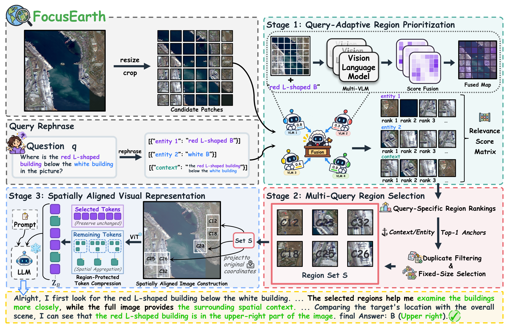

# FocusEarth: Where to Look and What to Preserve for Ultra-High-Resolution Remote Sensing VQA

<p align="center">
  Wanghao Sun<sup>1</sup>,
  Nanqing Liu<sup>1,*</sup>,
  Yu Sun<sup>1</sup>,
  Zhanxuan Hu<sup>1</sup>,
  Qi Ming<sup>2</sup>,
  Heng-Chao Li<sup>3</sup>
</p>

<p align="center">
  <sup>1</sup>Yunnan Normal University<br>
  <sup>2</sup>Beijing University of Technology<br>
  <sup>3</sup>Southwest Jiaotong University
</p>

<p align="center">
  <sup>*</sup>Corresponding author
</p>

## Overview

**FocusEarth** is a training-free framework that couples **where to look** in the source image with **what to preserve** in the encoded visual representation for ultra-high-resolution remote sensing visual question answering (UHR RS-VQA).

<p align="center">
  
</p>

FocusEarth consists of three stages:

- **Query-Adaptive Region Prioritization:** Derives entity and context descriptions and fuses regional responses from multiple frozen image–text encoders through score standardization and entropy matching.
- **Multi-Query Region Selection:** Integrates context and entity proposals under a shared region budget.
- **Spatially Aligned Visual Representation:** Maps selected source regions onto the encoded feature grid of a resized full-scene image, preserving their corresponding features individually while spatially aggregating the remaining features.

This repository provides the FocusEarth implementation and inference pipeline for MME-RealWorld-RS.

## Installation

Use Python 3.12 and a CUDA-capable environment for model inference. The package pins PyTorch 2.8.0, Transformers 4.57.6, OpenCLIP 3.3.0, spaCy 3.8.16, NumPy 2.3.2, Pillow 11.3.0, and PyYAML 6.0.2.

```bash
python3.12 -m venv .venv
. .venv/bin/activate
python -m pip install --upgrade pip
python -m pip install .
python -m pip install https://github.com/explosion/spacy-models/releases/download/en_core_web_sm-3.8.0/en_core_web_sm-3.8.0-py3-none-any.whl
```

The spaCy language model is required for entity extraction. Accelerate 1.12.0 supplies Qwen's automatic device placement. Run the lightweight checks with:

```bash
python -m unittest discover -s tests -v
```

## Model Preparation

Obtain the following checkpoints from their respective projects and store them outside this repository:

| Component | Required checkpoint | Configuration path |
| --- | --- | --- |
| CLIP | ViT-B/32 | `scoring_encoders.checkpoints.CLIP` |
| GeoRSCLIP | RS5M ViT-B/32 | `scoring_encoders.checkpoints.GeoRSCLIP` |
| RemoteCLIP | ViT-B/32 | `scoring_encoders.checkpoints.RemoteCLIP` |
| SkyCLIP-50 | ViT-B/32, top 50% training subset, epoch 20 | `scoring_encoders.checkpoints.SkyCLIP-50` |
| Qwen3-VL | `Qwen/Qwen3-VL-8B-Instruct` | `answer_model.checkpoint` |

Use Qwen revision `0c351dd01ed87e9c1b53cbc748cba10e6187ff3b`, including its processor and tokenizer files. Scoring checkpoint identities are checked against SHA-256 hashes listed in the [reproduction guide](docs/reproduction.md). Models load from local files; inference does not download missing weights. Load only trusted checkpoint files.

## Dataset Preparation

Obtain the official MME-RealWorld annotations and remote sensing source images independently. Set `dataset.annotations` to the annotation JSON file and `dataset.root` to the directory containing its relative `Image` paths. For example:

```text
MME-RealWorld-RS/
  remote_sensing/
    ... source images ...
```

The loader selects `Subtask = Remote Sensing` and validates 3,738 questions: Color (1,255), Count (1,226), and Position (1,257). Original question IDs, text, five option strings, labels, and annotation order are preserved. Dataset files and model weights are not distributed here.

## Inference

Fill the external paths in [configs/mme_realworld_rs.yaml](configs/mme_realworld_rs.yaml), then run from the repository root:

```bash
python scripts/eval_mme_realworld_rs.py \
  --config configs/mme_realworld_rs.yaml \
  --data-root /path/to/MME-RealWorld-RS \
  --output-dir outputs/mme_realworld_rs
```

`--annotations` can override the annotation path. Checkpoints are configured in YAML. The output directory must not already exist; the command does not overwrite or resume a previous run.

Four-encoder region scoring runs before Qwen answering. This offline scoring has its own computation and memory cost. Answering-stage latency excludes that scoring stage; total pipeline cost includes both stages.

## Evaluation

The prompt requests a concise, image-grounded `Evidence:` description followed by `Final answer:` with one MME option letter. The evaluator prioritizes this explicitly tagged answer. Letter-only, answer-tag, and supported JSON responses are also recognized. Arbitrary option letters inside explanations are not searched, and incomplete or malformed tagged answers are invalid.

Overall and category accuracies use every question in the canonical population. Invalid responses and execution failures count as incorrect. The command writes:

| File | Contents |
| --- | --- |
| `predictions.jsonl` | Question identity, raw response, extracted answer, ground truth, validity, correctness, and errors |
| `traces.jsonl` | Query descriptions, rankings, selected regions, canvas geometry, protected cells, token budgets, and generation lengths |
| `results.json` | Overall and category correct/total counts, accuracy, invalid responses, and execution failures |
| `run_manifest.json` | Effective configuration, checkpoint identities, annotation hash, library versions, and decoding settings |

## Reproducibility

The configuration checks the method's numerical settings. Qwen uses bfloat16, SDPA attention, greedy decoding, and at most 64 generated tokens. Region ranking, geometric rounding, group allocation, and output ordering are deterministic.

Lightweight fixtures check geometry, fusion, selection, query processing, answer extraction, configuration, and model interfaces. See the [reproduction guide](docs/reproduction.md) for runtime requirements and the scope of these checks.

## Citation

This repository accompanies *FocusEarth: Where to Look and What to Preserve for Ultra-High-Resolution Remote Sensing VQA*.

## Acknowledgements

FocusEarth uses CLIP, GeoRSCLIP/RS5M, RemoteCLIP, SkyCLIP/SkyScript, Qwen3-VL, OpenCLIP, Transformers, spaCy, and MME-RealWorld. The public package provides MME-RealWorld-RS inference and evaluation; external models and datasets remain subject to their respective terms.
